<p align="center">
  
</p>

<p align="center">
  
</p>

<p align="center">
  
  
  
  
</p>

## Overview

A Spring Boot REST API for managing events and feedback. It includes JWT authentication, Spring Data JPA persistence, auditing, Swagger/OpenAPI documentation and a MySQL database.

## Highlights

- JWT authentication and registration
- Event and feedback CRUD endpoints
- Spring Data JPA persistence with auditing
- OpenAPI / Swagger documentation
- MySQL integration

## Tech stack

<p align="center">
  
</p>

## Getting started

**Prerequisites:** JDK 17+, MySQL and Maven.

```bash
cd crud_event
./mvnw spring-boot:run
```

## Project structure

```text
crud_event/    Spring Boot application
  src/main/java/tn/esprit/spring/event/
```

---

<p align="center">
  
</p>

<p align="center">
  Built by <a href="https://github.com/Skander-Bardaoui"><b>Skander Bardaoui</b></a> ·
  <a href="https://skander-bardaoui.netlify.app/">Portfolio</a> ·
  <a href="https://github.com/Skander-Bardaoui?tab=repositories">All repositories</a>
</p>
